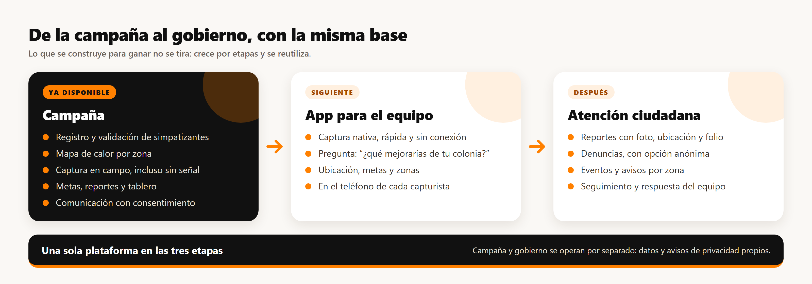

# Sistema de Simpatizantes y App Móvil
### Documento de beneficios y alcance

> **Cómo usar este documento.** Cada sección trae un recuadro `INSERTAR IMAGEN` con la captura sugerida.
> Guarde las imágenes en la carpeta `docs/imagenes/` con el nombre indicado y reemplace el marcador;
> o péguelas directamente al pasar este contenido a Word, Google Docs o PowerPoint.

---

## 1. Resumen ejecutivo

El **Sistema de Simpatizantes** es una plataforma completa para organizar, validar y dar seguimiento a la base de apoyo de una campaña, y comunicarse con ella de forma ordenada y respetuosa de la ley.

Está formado por tres piezas que trabajan sobre la misma información:

| Pieza | Para quién | Qué resuelve |
|---|---|---|
| **Sistema web (panel de gestión)** | Candidato, coordinadores y administradores | Ver, validar, medir y comunicarse con los simpatizantes desde cualquier computadora |
| **App móvil para el equipo** | Capturistas y brigadas en campo | Registrar personas en la calle, incluso sin señal, y conocer las necesidades de cada colonia |
| **App móvil para la ciudadanía** | Vecinas y vecinos | Reportar problemas, hacer denuncias, enterarse de eventos de su zona y mantenerse cerca |

**En una frase:** convierte el trabajo de calle en información confiable, ordenada y accionable, y abre un canal directo con la comunidad que puede seguir sirviendo después de la campaña.

<!-- INSERTAR IMAGEN: imagenes/portada-web-y-movil.png
     Sugerencia: composición con el panel web en una laptop y la app móvil en un teléfono. -->

---

## 2. El problema que resuelve

Las campañas suelen trabajar con listas en hojas de cálculo, formatos en papel y mensajes sueltos. Eso provoca:

- Registros repetidos, incompletos o con datos mal capturados.
- No saber qué zonas ya se trabajaron y cuáles faltan.
- Capturistas sin metas claras y sin forma de medir su avance.
- Datos de personas sin control de quién los ve ni de qué permiso hay para contactarlas.
- Información de campo que llega tarde, o que se pierde cuando no hay señal.
- Ninguna forma sencilla de escuchar lo que realmente necesita cada colonia.

El sistema ordena todo esto en un solo lugar, con reglas automáticas que cuidan la calidad de los datos y la privacidad de las personas.

---

## 3. Sistema web: panel de gestión

### 3.1 Acceso seguro y por niveles

Cada persona entra con su propio usuario y ve solamente lo que le corresponde: el administrador ve todo, el coordinador su campaña y el capturista únicamente su propio trabajo.

**Beneficios**
- Cada quien accede solo a lo que necesita; la información sensible no circula de más.
- Se sabe quién hizo qué y cuándo, gracias al registro de auditoría.
- La pantalla de acceso lleva la imagen de la campaña, para que el sistema se sienta propio.

<!-- INSERTAR IMAGEN: imagenes/web-login.png
     Captura de la pantalla de inicio de sesión con el cartel de la campaña. -->

---

### 3.2 Registro y validación de simpatizantes

Alta de cada persona con sus datos de contacto, domicilio, sección electoral, ubicación, firma y fotografía de identificación.

**Beneficios**
- **Datos correctos desde el origen:** el sistema revisa en el momento el formato de la CURP y la clave de elector, los teléfonos y las secciones.
- **Cero duplicados:** avisa de inmediato si la persona ya está registrada, y evita que dos capturistas registren a la misma.
- **Validación con respaldo:** cada registro pasa por los estados *pendiente*, *validado* o *rechazado*; los rechazos llevan su motivo y todo queda en un historial.
- **Calidad visible:** en la ficha de cada persona se señalan inconsistencias para corregirlas.

<!-- INSERTAR IMAGEN: imagenes/web-formulario-registro.png
     Formulario de nuevo simpatizante mostrando un aviso de duplicado o de dato por corregir. -->

<!-- INSERTAR IMAGEN: imagenes/web-ficha-simpatizante.png
     Ficha de una persona con su estado de validación, historial y calidad de datos. -->

---

### 3.3 Carga masiva y exportación

Importación de listas desde Excel o CSV y exportación de la información con los filtros que se necesiten.

**Beneficios**
- **Se aprovecha lo que ya existe:** las listas previas se cargan en minutos, con una revisión antes de guardar que muestra qué entrará, qué está repetido y qué trae errores.
- **Reporte de lo omitido:** se descarga la lista de filas con problemas para corregirlas.
- **Exportación segura:** cada persona exporta únicamente lo que su nivel le permite, y cada descarga queda registrada.

<!-- INSERTAR IMAGEN: imagenes/web-importar.png
     Pantalla de revisión de una importación con el resumen de listos, duplicados y errores. -->

---

### 3.4 Mapa de calor

Visualización geográfica de dónde está el apoyo, con filtros por campaña, fechas y estado de validación.

**Beneficios**
- Se ve de un vistazo **qué zonas están fuertes y cuáles descuidadas**.
- Al acercarse, la vista se despeja y muestra puntos individuales, sin tapar el mapa.
- Se descarga como imagen, con título, filtros y fecha, lista para una presentación.

<!-- INSERTAR IMAGEN: imagenes/web-mapa-calor.png
     Mapa de calor completo de la zona de trabajo. -->

<!-- INSERTAR IMAGEN: imagenes/web-mapa-calor-zoom.png
     El mismo mapa acercado, mostrando puntos individuales. -->

---

### 3.5 Tablero y reportes

Indicadores en tiempo real con comparativos contra el periodo anterior, ranking de capturistas y avance por sección y municipio.

**Beneficios**
- **Decisiones con datos:** cuánto creció la base, qué porcentaje está validado y dónde se concentra el trabajo.
- **Comparativos claros:** cada cifra muestra si sube o baja frente al periodo anterior.
- **Reconocimiento al equipo:** ranking de capturistas con su porcentaje de validación.
- **Reporte semanal automático en PDF**, enviado por correo al candidato, coordinadores y administradores, sin que nadie tenga que armarlo.

<!-- INSERTAR IMAGEN: imagenes/web-dashboard.png
     Panel principal con indicadores y gráfica de actividad. -->

<!-- INSERTAR IMAGEN: imagenes/web-reportes.png
     Pantalla de reportes con comparativo, estados de validación y municipios. -->

<!-- INSERTAR IMAGEN: imagenes/reporte-semanal-pdf.png
     Primera página del reporte semanal en PDF. -->

---

### 3.6 Metas y zonas de trabajo

Metas de captura por campaña, por capturista o por sección, y asignación de zonas a cada persona del equipo.

**Beneficios**
- Cada capturista sabe **cuánto debe lograr y dónde**; el avance se ve en vivo.
- Se evita que todos trabajen la misma colonia y se descuiden otras.
- Si alguien registra fuera de su zona, el sistema le avisa.

<!-- INSERTAR IMAGEN: imagenes/web-metas-zonas.png
     Pantalla de metas con barras de avance y zonas asignadas. -->

---

### 3.7 Captura en campo desde el navegador

Una versión instalable en el teléfono que funciona **sin conexión** y envía los registros solos al regresar la señal.

**Beneficios**
- El trabajo de campo **no se detiene** por falta de internet.
- Cada registro se envía una sola vez, sin duplicarse aunque el teléfono reintente.
- Toma la ubicación automáticamente, con aviso claro de para qué se usa.

<!-- INSERTAR IMAGEN: imagenes/web-captura-movil.png
     La captura en campo vista en un teléfono. -->

---

### 3.8 Comunicación con simpatizantes

Listas segmentadas, mensajes por WhatsApp con un clic, correos a grupos y una bitácora de cada contacto.

**Beneficios**
- **Mensajes a la medida:** se arman listas por sección, municipio, estado de validación o "personas sin contacto en mucho tiempo".
- **WhatsApp ágil:** un botón abre la conversación con el mensaje ya escrito y con el nombre de la persona; el contacto se registra solo.
- **Plantillas editables** de bienvenida, seguimiento e invitaciones, sin depender de un programador.
- **Respeto a la privacidad:** el correo masivo solo sale a quien aceptó recibirlo, y cada mensaje incluye su enlace para darse de baja.
- **Historial completo:** llamadas, visitas y mensajes quedan en la ficha de cada persona.

<!-- INSERTAR IMAGEN: imagenes/web-comunicacion.png
     Pantalla de comunicación con filtros, lista y botones de WhatsApp. -->

<!-- INSERTAR IMAGEN: imagenes/web-plantillas.png
     Editor de plantillas con vista previa. -->

---

### 3.9 Lo que piden los vecinos

Al registrar a una persona se le pregunta **qué le gustaría mejorar en su colonia**. Las respuestas se concentran en reportes.

**Beneficios**
- La campaña **escucha antes de prometer**: se sabe qué necesita cada zona.
- Propuestas y discursos basados en lo que la gente realmente pide.
- Si se gobierna, ese diagnóstico es un punto de partida para priorizar acciones.

<!-- INSERTAR IMAGEN: imagenes/web-lo-que-piden.png
     Gráfica o lista de "Lo que piden los vecinos" en reportes. -->

---

### 3.10 Registro público

Un formulario abierto, con aviso de privacidad, para que las personas se sumen por su cuenta desde un enlace o un código QR.

**Beneficios**
- La base crece sola en eventos, redes sociales y propaganda.
- Cada persona acepta expresamente los términos y, si lo desea, recibir mensajes.
- Los registros entran como *pendientes* para que el equipo los revise antes de darlos por buenos.

<!-- INSERTAR IMAGEN: imagenes/web-registro-publico.png
     Formulario público de registro. -->

---

### 3.11 Seguridad, respaldo y control

**Beneficios**
- **Auditoría:** registro de quién entró, qué cambió, qué exportó y qué envió.
- **Respaldos automáticos** de la base de datos y de los archivos, para recuperarse ante cualquier problema.
- **Protección de documentos:** las fotografías de identificación y firmas solo las ven quienes tienen permiso.
- **Bloqueo por intentos fallidos** y sesiones que se cierran por inactividad.
- **Rendimiento:** pensado para seguir rápido conforme crece la base.
- **Configuración sencilla** desde el propio sistema: nombre, colores, términos y avisos.

<!-- INSERTAR IMAGEN: imagenes/web-auditoria.png
     Pantalla de auditoría con el registro de acciones. -->

<!-- INSERTAR IMAGEN: imagenes/web-configuracion.png
     Pantalla de configuración y respaldos. -->

---

## 4. App móvil

Una sola aplicación para iPhone y Android, con **dos caras**: al iniciar sesión se abre la que corresponde según el tipo de cuenta. El equipo entra con el mismo usuario y contraseña del sistema web; la ciudadanía crea su propia cuenta.

<!-- INSERTAR IMAGEN: imagenes/movil-login.png
     Pantalla de inicio de sesión de la app con el cartel de la campaña. -->

### 4.1 Cara del equipo: captura en campo

Pensada para quien trabaja en la calle, con una mano y poco tiempo.

**Características**
- **Funciona sin conexión.** Todo se guarda en el teléfono y se envía solo al volver la señal, sin duplicar registros.
- **Formulario rápido y claro**, con campos amplios, ayudas visuales y mensajes de error comprensibles.
- **Ubicación automática** del registro, con aviso de para qué se usa; también se puede guardar sin ella.
- **Pregunta sobre la colonia:** temas para marcar (agua, drenaje, seguridad, alumbrado, baches, basura, transporte, salud, educación, empleo, parques) y un comentario con las palabras de la persona.
- **Consentimiento registrado:** se marca si la persona aceptó recibir mensajes de la campaña.
- **Bandeja de pendientes:** muestra lo que falta por enviar y permite corregir los registros rechazados, con el motivo a la vista.
- **Metas y zonas:** cada capturista ve su avance y las secciones que tiene asignadas, y la app avisa si registra fuera de ellas.
- **Seguridad en el teléfono:** la sesión se guarda de forma protegida y puede cerrarse a distancia si un teléfono se pierde.
- **Actualización controlada:** el sistema puede pedir que se actualice la app cuando haya cambios importantes.
- **Diseño cuidado:** navegación flotante, animaciones suaves y vibraciones discretas.

<!-- INSERTAR IMAGEN: imagenes/movil-equipo-captura.png
     Formulario de captura con el selector de temas de colonia. -->

<!-- INSERTAR IMAGEN: imagenes/movil-equipo-pendientes.png
     Bandeja de pendientes, con un registro por corregir. -->

<!-- INSERTAR IMAGEN: imagenes/movil-equipo-metas.png
     Pantalla de metas y secciones asignadas. -->

<!-- INSERTAR IMAGEN: imagenes/movil-barra-flotante.png
     Detalle de la barra de navegación flotante. -->

---

### 4.2 Cara ciudadana: atención y cercanía

Un canal directo entre la comunidad y el equipo.

**Características**
- **Reportar un problema de la colonia:** baches, alumbrado, agua y drenaje, basura, seguridad u otro, con foto, ubicación y descripción.
- **Folio de seguimiento:** cada reporte recibe un número y la persona ve en qué etapa va (recibido, en revisión, atendido), con aviso cuando cambia.
- **Denuncias:** una vía aparte, con opción de **enviarse de forma anónima** y aviso claro de que no sustituye a la autoridad ni al servicio de emergencias.
- **Eventos de su zona:** reuniones, jornadas y recorridos, con la opción de confirmar asistencia.
- **Avisos** por colonia o municipio, publicados desde el panel del equipo.
- **Participación voluntaria:** si lo desea, puede pedir sumarse como simpatizante; solo ocurre si ella lo solicita.
- **Control de sus datos:** puede leer el aviso de privacidad y **eliminar su cuenta** desde la propia app.

> **Conexión con el sistema.** Todo lo que la ciudadanía reporta, confirma o solicita se guarda en el servidor y llega al panel de Atención ciudadana, donde el equipo responde, cambia el estado y publica eventos y avisos.

<!-- INSERTAR IMAGEN: imagenes/movil-ciudadano-inicio.png
     Pantalla de inicio del ciudadano con evento y avisos. -->

<!-- INSERTAR IMAGEN: imagenes/movil-ciudadano-reportar.png
     Pantalla de reportar, con categorías, foto y ubicación. -->

<!-- INSERTAR IMAGEN: imagenes/movil-ciudadano-folio.png
     Detalle de un reporte con su folio y línea de seguimiento. -->

<!-- INSERTAR IMAGEN: imagenes/movil-ciudadano-eventos.png
     Lista de eventos de su zona. -->

<!-- INSERTAR IMAGEN: imagenes/movil-ciudadano-cuenta.png
     Pantalla de cuenta, avisos y privacidad. -->

---

## 5. De la campaña al gobierno: la misma plataforma

Lo que se construye para ganar **no se tira**: crece por etapas y se reutiliza.

| Etapa | Qué ofrece |
|---|---|
| **Campaña** | Registro y validación de simpatizantes, mapa de calor, captura en campo, metas, reportes y comunicación |
| **App del equipo** | Todo lo anterior en el teléfono de cada capturista, con la voz de la colonia incluida |
| **Atención ciudadana** | Reportes, denuncias, eventos y avisos para la comunidad, con seguimiento y respuesta |

**Principios para hacerlo bien**
- **Campaña y gobierno se separan.** Si se gana, la atención ciudadana opera como canal institucional: con su propio aviso de privacidad, sus propios datos y sin usar las listas de la campaña. Conviene definirlo desde ahora y revisarlo con asesoría jurídica electoral.
- **Los datos se cuidan.** La afinidad política y las denuncias son información sensible: cada uso tiene su consentimiento, y toda persona puede pedir su baja o borrar su cuenta.
- **Se promete solo lo que se puede atender.** El panel muestra tiempos y pendientes para fijar compromisos realistas con la comunidad.

<!-- INSERTAR IMAGEN: imagenes/ruta-campana-gobierno.png
     Esquema simple de las tres etapas (puede hacerse en una diapositiva). -->

---

## 6. Beneficios por perfil

**Para la candidatura**
- Conoce, con datos confiables, dónde tiene fuerza y dónde no.
- Recibe cada semana un reporte claro sin pedirlo.
- Escucha lo que necesita cada colonia antes de hablar en ella.
- Cuida su imagen: la comunicación respeta consentimientos y bajas.

**Para la coordinación**
- Reparte zonas y metas, y ve el avance de cada persona.
- Valida registros con motivo y historial.
- Identifica pendientes y personas sin contacto reciente.

**Para el equipo de campo**
- Captura rápido, incluso sin señal.
- Sabe cuánto lleva y cuánto falta.
- Recibe avisos claros y puede corregir sus errores sin perder el registro.

**Para la ciudadanía**
- Un canal directo, sencillo y con seguimiento.
- Información de eventos de su zona.
- Control sobre sus datos.

---

## 7. Seguridad y cumplimiento

- Acceso con usuario y niveles de permiso.
- Registro de auditoría de acciones importantes.
- Consentimiento para recibir mensajes, con baja inmediata y reversible solo por un administrador.
- Aviso de privacidad y términos en el registro público.
- Protección de documentos personales y de la información exportada.
- Respaldos automáticos y recuperación ante fallas.
- Comunicación cifrada entre la app y el sistema.
- Cierre remoto de sesiones en teléfonos perdidos.
- Borrado de cuenta por parte de la propia persona.

---

## 8. Componentes del proyecto

Para efectos de la propuesta económica, el proyecto se compone de:

1. **Sistema web de gestión** (registro, validación, mapa, tablero, reportes, metas y zonas, comunicación, auditoría y respaldos).
2. **Captura en campo desde el navegador**, instalable y con trabajo sin conexión.
3. **App móvil para el equipo**, para iPhone y Android.
4. **App móvil para la ciudadanía**, con reportes, denuncias, eventos y avisos.
5. **Módulo de atención ciudadana en el servidor** (bandeja de reportes, respuestas, eventos, avisos y moderación).
6. **Publicación en las tiendas de aplicaciones** (cuentas, fichas, revisión y distribución).
7. **Capacitación** al equipo y a los capturistas.
8. **Soporte y mantenimiento** posteriores a la puesta en marcha.
9. **Alojamiento, correo y servicios de terceros** necesarios para operar.

> El documento no incluye cifras: sirve como base para integrar la cotización con los conceptos anteriores.
